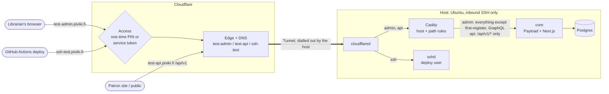
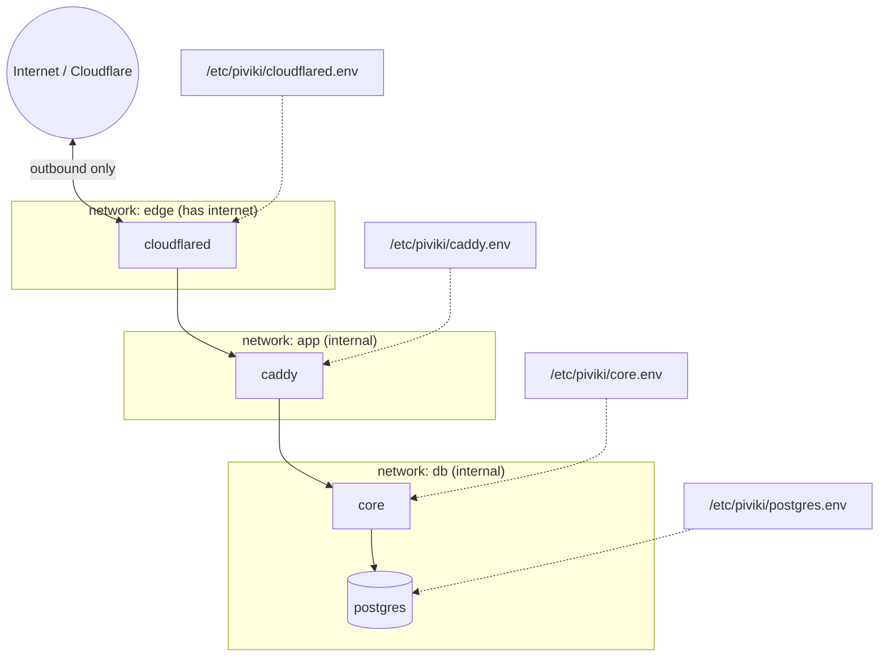

# piviki-infra

Piviki's shared infrastructure: the Cloudflare configuration (OpenTofu), the one-time host
setup, the runbooks and the secrets inventory. What a host *runs* for core (Compose, Caddy, the
deploy script and its checks) lives with the app in
[`piviki-core/deploy`](https://github.com/piviki-org/piviki-core/tree/main/deploy), so a core
commit names its whole host runtime (AD-21). The patron site, later, is static on Cloudflare and
shares this repository's Cloudflare setup.

> **Status:** story 1.1 (the tracer bullet) on the **test** environment: the AWS host is
> bootstrapped as `test`; production's shared OpenTofu state, test's state and the first deploy
> are still to be run end to end, following the runbooks in [`docs/`](docs/). Production (OVH)
> starts later, in `epic-soft-open`.

## Principles

- **No inbound ports except SSH.** Web traffic reaches the host only through a Cloudflare Tunnel
  that the host dials out to. Compose publishes no ports.
- **Same files on every host.** Production and test run the same bootstrap and the same
  `piviki-core/deploy`. Everything that differs between environments is runtime configuration
  in `/etc/piviki/` on that host, never in a repository or an image.
- **One host runtime version per host (AD-21).** The bootstrap clones `piviki-core` root-owned
  to `/opt/piviki/core` at a commit a founder names; sudoers points at that checkout's deploy
  script. A deploy only names the image tag and refuses one whose `deploy/` differs from the
  checkout. Only a founder moves the checkout (`bootstrap.sh --move-core`).
- **Each service sees only its own secrets.** One root-owned env file per service.
- **Hosts never build.** CI builds the core image; a host only pulls a tagged image.
- **Cloudflare as code, servers by hand.** OpenTofu manages Cloudflare (DNS, Tunnel, Access).
  The EC2 instance or VPS is created by hand from a checklist.
- **One state per environment; shared resources only in production's (AD-17).** `tofu/prod`
  holds the `piviki.fi` zone, the coming-soon records and the One-time PIN login method; each
  environment's Tunnel, Access and records come from the `core-ingress` module in its own root
  (`tofu/test` now; `tofu/prod` at the production start). Test takes the shared ids as plain
  values, so destroying test removes nothing production uses.
- **One environment name per host.** `/etc/piviki/environment` (`test` or `production`); core
  refuses to start, and the deploy checks fail, when a host name disagrees with it.

## Stack

| Part | Version | Role |
|---|---|---|
| Ubuntu Server LTS, x86_64 | same release on every host | Host OS: AWS EC2 for test, OVHcloud VPS-1 for production |
| nftables | Ubuntu package | Host firewall: inbound SSH only |
| Docker Engine + Compose plugin | Docker's apt repository | Runs the stack |
| `cloudflared` | 2026.10.7, pinned by digest in `piviki-core/deploy` | Tunnel connector: the only way in for web traffic |
| Caddy | 2.11.7, pinned by digest in `piviki-core/deploy` | Routes by host and path on the private network |
| `piviki-core` | `ghcr.io/piviki-org/piviki-core:<commit>-<date>` | Payload CMS and Next.js: the admin and `/api/v1` |
| PostgreSQL | 18.6, pinned by digest in `piviki-core/deploy` | The database, reachable only by core |
| OpenTofu | 1.13.2 | Manages the Cloudflare resources |
| Cloudflare provider | `~> 5.28` | Zone, DNS, Tunnel and Access resources |

## Folder structure

```
piviki-infra/
├── bootstrap/
│   ├── bootstrap.sh          one host setup: Docker, firewall, sshd, deploy user, /etc/piviki,
│   │                         the piviki-core checkout (re-runnable; --move-core moves the
│   │                         checkout; --check re-runs the host checks)
│   ├── files/etc/...         every config file it installs, at its path on the host
│   ├── host-files.sh         the list of those files, their modes and validators (shared)
│   └── validate-files.sh     validates files/ with the hosts' own programs (run by CI)
├── tofu/
│   ├── prod/                 production's state: shared resources only (for now)
│   │   ├── versions.tf       tool/provider pins, R2 state backend, state encryption
│   │   ├── zone.tf           imports the existing piviki.fi zone (never creates or deletes it)
│   │   ├── dns.tf            imports the coming-soon records (no change)
│   │   ├── access.tf         the One-time PIN login method (created or imported)
│   │   ├── variables.tf, outputs.tf   outputs: zone_id, otp_identity_provider_id for test
│   │   └── *.example         copy to backend.hcl / terraform.tfvars (git-ignored)
│   ├── test/                 test's state: only test-named resources, own key and passphrase
│   │   ├── main.tf           calls modules/core-ingress with the test hosts
│   │   ├── versions.tf, variables.tf, outputs.tf
│   │   └── *.example
│   └── modules/core-ingress/ one environment's route in to core's host
│       ├── tunnel.tf         the Tunnel and its routes
│       ├── access.tf         Access apps, policies and the deploy service token
│       └── dns.tf            ssh, admin and api records
├── docs/
│   ├── secrets-inventory.md  every secret by name: where it lives, who reads it
│   ├── runbook-host-setup.md Bitwarden, create the instance, bootstrap, hardening checks
│   └── runbook-first-deploy.md GitHub, Cloudflare, env files, first deploy, seeding, DNS, verification
└── .github/
    ├── dependabot.yml        weekly updates for the providers and Actions
    └── workflows/host-files.yml  on every PR: validate bootstrap/files in Ubuntu 26.04, shellcheck,
                              tofu fmt and validate on tofu/prod and tofu/test
```

On a host, next to this repository's checkout at `/opt/piviki/infra`:

```
/opt/piviki/core/deploy/      piviki-core's host runtime, at the commit a founder placed (AD-21)
├── compose.yml               the stack: cloudflared, caddy, core, postgres
├── caddy/Caddyfile           host and path rules
├── env-manifest              exactly the files under /etc/piviki and their keys
├── deploy.sh                 the deploy user's only command (sudoers names this path)
├── host-checks.mjs           in-network checks after each deploy
└── piviki-compose            founder helper, linked from /usr/local/sbin
/etc/piviki/*.env             one root-owned env file per service, from env-manifest
/var/lib/piviki/              the recorded tag (compose.env) and deploys.log
```

## Moving parts

### Request flow



What each layer refuses:

| Layer | Refuses |
|---|---|
| Cloudflare Access | Anyone on `admin` without a one-time PIN for a listed email (no token passes it); anyone on `ssh-<env>` without the deploy token |
| `cloudflared` | Requests to `admin` and `ssh-<env>` without a valid Access token; any other host name (404) |
| Caddy | Unknown hosts, backslashes in paths, first-register, GraphQL, a foreign `Origin` on admin (403), anything on `api` outside `/api/v1/*` (all 404 unless noted) |
| core | Every operation not explicitly allowed (deny-by-default collections), first-register (again), GraphQL, running jobs over HTTP; starting at all with a host name that disagrees with the host's environment name |
| Host firewall | Every inbound connection except SSH |

### Containers and networks



- Caddy sits on both `edge` and `app`, and core on both `app` and `db`. Only `edge` has a route
  out, so core cannot reach the internet or the cloud metadata service.
- No service publishes a port. Postgres is reachable only from core.
- Core runs as a non-root user on a read-only filesystem with all capabilities dropped, and
  connects to Postgres as the non-superuser `piviki_core` role.

### Build and deploy

```mermaid
sequenceDiagram
  autonumber
  actor F as Founder
  participant B as build workflow (piviki-core)
  participant R as GHCR
  participant D as deploy workflow
  participant A as Cloudflare Access + Tunnel
  participant H as Host: piviki-deploy

  F->>B: push to main
  B->>B: typecheck, tests
  B->>R: push piviki-core:COMMIT-DATE
  opt the commit changed deploy/
    F->>H: bootstrap.sh --move-core COMMIT (founder over SSH)
  end
  F->>D: run workflow (environment, TAG)
  D->>D: COMMIT is on main; check out its deploy/checks.sh
  D->>A: ssh deploy@ssh-test (service token)
  A->>H: deploy test TAG
  H->>H: refuse unless checkout clean and deploy/ = COMMIT's
  H->>R: pull the tag
  H->>H: start postgres, run migrations
  H->>H: start the stack, wait for health
  H->>H: host-checks.mjs (first-register 404, allowlist, health, Origin, unknown host)
  H-->>D: record the tag (only if checks pass)
  D->>D: checks.sh: admin redirects to Access, api allowlist, one Tunnel connector
  D->>D: GitHub deployment record with the tag
```

Rollback is a deploy of the previous tag, which is listed in `/var/lib/piviki/deploys.log` on the
host and in the GitHub deployment records. If that tag's `deploy/` differs, a founder moves the
checkout to its commit first. Schema changes are only ever fixed forward.

### Setting up a host, in order

```mermaid
flowchart LR
  z["Bitwarden<br/>runbook-host-setup §0"] --> a
  a["Create instance<br/>runbook-host-setup §1-3"] --> y["Push repos, first image<br/>runbook-first-deploy §1"]
  y --> b["bootstrap.sh --core-commit<br/>runbook-host-setup §4"]
  b --> c["Cloudflare tokens<br/>+ tofu/prod: shared, no change<br/>+ tofu/test: Tunnel, Access, ssh record"]
  c --> d["Fill /etc/piviki/*.env"]
  d --> e["GitHub Environment<br/>vars + secrets"]
  e --> f["First deploy<br/>(no public records yet)"]
  f --> g["Seed first librarian<br/>over SSH"]
  g --> h["tofu/test: admin + api records"]
  h --> i["Deploy again with public checks,<br/>then verification"]
```



The first librarian is seeded **before** the `admin` and `api` records exist, so there is never a
public moment with no account. Steps c to i are in [`docs/runbook-first-deploy.md`](docs/runbook-first-deploy.md).

## Secrets

Values are never in a repository. Each one is stored first in Bitwarden (the founders' free
EU organisation, AD-17) and copied to the one place that uses it: a host env file under
`/etc/piviki/`, a GitHub Environment secret, or a founder's shell for OpenTofu. The `age` backup
key is the one secret kept offline instead. [`docs/secrets-inventory.md`](docs/secrets-inventory.md)
lists them all by name.

OpenTofu state is stored per environment in a private R2 bucket of its own in Cloudflare's EU
jurisdiction (`piviki-prod-tofu-state-eu`, `piviki-test-tofu-state-eu`) that holds nothing else,
each reached with its own founder-held R2 token and encrypted with its own passphrase before
upload. Each environment also has its own OpenTofu Cloudflare API token.

## Local stack

The local stack now lives with core: see
[`piviki-core/deploy/README.md`](https://github.com/piviki-org/piviki-core/blob/main/deploy/README.md).

## License

MIT. See [LICENSE](LICENSE).
